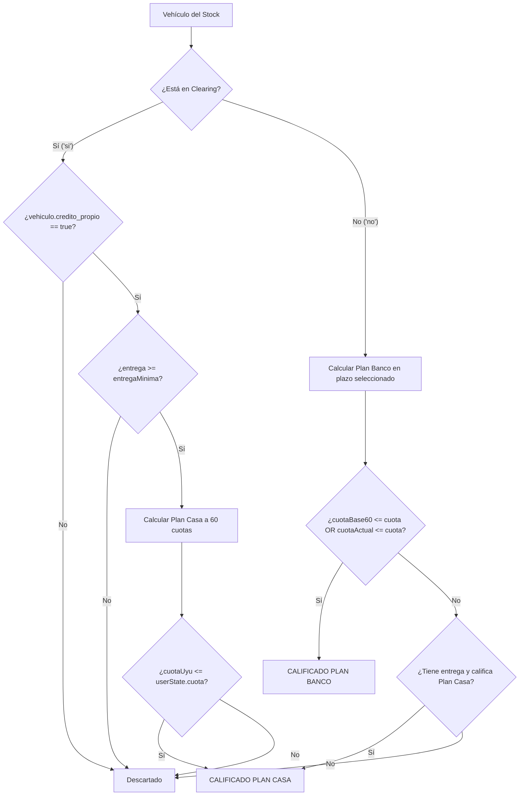

# CONTEXTO MAESTRO DEL PROYECTO: APP VALOR CUOTA (GRIT AUTOMOTORES)
> **DOCUMENTO PARA AGENTES DE IA Y DESARROLLADORES**  
> *Este archivo contiene el 100% del conocimiento del sistema, decisiones arquitectónicas, fórmulas financieras, flujos de UX, base de datos y lecciones aprendidas de datos empíricos de producción. Leé este documento antes de realizar cualquier cambio.*

---

## 1. Identidad y Misión del Negocio

- **Cliente:** Grit Automotores (Montevideo, Uruguay).
- **Dirección física:** Nueva Palmira 2061 / 2064, Montevideo.
- **Equipo comercial:** Sebastián (+598 97 300 504) y Hernán.
- **Propósito de la App:** Calificar financieramente a prospectos mediante un flujo conversacional guiado en 3 pasos, calcular su cuota real determinista según su situación crediticia (Bancaria o Crédito de la Casa), presentarles un catálogo filtrado de stock propio y derivarlos con perfil cerrado vía WhatsApp a Sebastián.
- **Lema oficial de conversión:** *"En Grit siempre le buscamos la vuelta"* (especialmente orientado a personas en Clearing).

---

## 2. Repositorio, Tecnologías y Entornos

- **Repositorio Git:** `patriciolettieri052-byte/mi-proximo-auto-grit` (rama principal: `main`).
- **Arquitectura:** Single Page Application (SPA) en Vanilla JavaScript + CSS moderno (Design Tokens) + HTML5 semántico.
- **Backend Serverless:** Vercel Functions (`/api/*.js` en Node.js ES Modules).
- **Base de Datos & CDN:** Supabase PostgreSQL (`tyywkunwrdgtxslrqxox.supabase.co`) con bucket Storage público `vehiculos/grit/`.
- **Estrategia Resiliente (Híbrida):** Si la conexión a Supabase se interrumpe, el sistema conmuta automáticamente a los archivos de respaldo locales en `data/stock.json`, `data/config.json` y `data/leads.json`. La app **nunca se cae**.

---

## 3. Estructura de Directorios y Responsabilidad de Archivos

```text
app valor cuota grit/
├── .env                     # Variables de entorno locales
├── api/
│   ├── asistente.js         # Serverless: Proxy seguro hacia OpenAI GPT-4o-mini
│   └── leads.js             # Serverless: Inserción y actualización (upsert) en grit_leads
├── assets/
│   ├── local-grit.webp      # Fotografía oficial de la fachada de Grit Automotores
│   └── [fotos vehículos]   # Copias locales de respaldo de fotos de stock
├── css/
│   ├── tokens.css           # Design Tokens (colores, sombras, radios, tipografías)
│   └── app.css              # Estilos de todas las vistas, componentes y estados responsivos
├── data/
│   ├── config.json          # Respaldo offline de parámetros financieros y contactos
│   ├── stock.json           # Respaldo offline del catálogo de vehículos activos
│   └── leads.json           # Respaldo offline de leads en entornos sin filesystem de sólo lectura
├── img/
│   └── logo.png             # Logo oficial de Grit Automotores
├── js/
│   ├── main.js              # Inicializador, router SPA (ir(vista)), ciclo de vida
│   ├── chat.js              # Flujo conversacional, máquina de estados en 3 pasos y chips
│   ├── session.js           # Estado global userSession, sessionStorage y sync con backend
│   ├── finance.js           # Motor financiero determinista (calcPlanBanco, calcPlanCasa, etc.)
│   ├── matcher.js           # Algoritmo de calificación crediticia y ordenamiento de autos
│   ├── render.js            # Renderizado de cards, hero, banner de permuta, plazos y empty state
│   ├── stock.js             # Carga híbrida Supabase -> Fallback local
│   ├── supabase.js          # Cliente fetch vanilla para REST y CDN de Supabase
│   ├── ia.js                # Cliente frontend de IA (llamada a /api/asistente y fallback regex)
│   ├── whatsapp.js          # Generación de mensajes y enlaces estructurados a WhatsApp
│   ├── theme.js             # Switch y persistencia de Modo Claro / Modo Oscuro
│   └── analytics.js         # Eventos de tracking Google Analytics 4 (GA4)
├── index.html               # SPA principal con las 4 vistas
├── server.cjs               # Servidor local Node para pruebas de desarrollo
├── DOCUMENTACION_PROYECTO.md # Resumen funcional
└── CONTEXTO_AGENTE_IA.md   # Este archivo (Guía técnica maestra)
```

---

## 4. Las Vistas de la SPA (`index.html`)

La SPA gestiona la navegación con la función global `ir(nombreVista)` alternando la clase `.on`:

1. **`#vOnboarding` (Vista 0 - Entrada):**
   - Pide **Nombre** y **Celular (WhatsApp)**.
   - Badge destacado: *"¿Estás en Clearing? En Grit siempre le buscamos la vuelta. No es bloqueante para tener tu auto: financiamos directo con Crédito de la Casa propio..."*.
   - Badges de confianza: Salón físico en Montevideo, tomamos permutas, títulos al día.
   - Al pulsar *"Comenzar búsqueda"*, guarda el lead en Supabase (`/api/leads`) y pasa inmediatamente al chat sin fricción.

2. **`#vChat` (Vista 1 - Calificación Conversacional):**
   - Asistente virtual con retardo natural (150ms).
   - **Paso 1:** Pregunta de Clearing desestigmatizada con lema de marca. Opciones: `Sí, estoy en Clearing` | `No, sin atrasos`.
   - **Paso 2:** Monto estimado de entrega inicial en USD (o vehículo en permuta).
   - **Paso 3:** Presupuesto de cuota mensual máxima en pesos uruguayos (UYU).
   - Input de texto libre con procesamiento IA (`gpt-4o-mini`) y fallback regex local.

3. **`#vAutos` (Vista 2 - Catálogo Personalizado):**
   - **Hero físico (`.local-hero`):** Foto real del local con estado *"Local abierto · Lun a Vie 9 a 19 · Sáb 9 a 13"* posicionado en el extremo inferior (`bottom: 9px; left: 10px`) para dejar 100% visible el cartel superior.
   - **Selector de plazos bancarios (`#plazos`):** Botones `12 | 24 | 36 | 60 cuotas` (exclusivo para Plan Banco; se oculta en Plan Casa).
   - **Ajuste fino (`#ajuste`):** Sliders para recalcular entrega y cuota en tiempo real.
   - **Banner de permuta (`.banner-permuta-clearing`):** *"¿No llegás al 50% en efectivo? Tomamos tu usado"*.
   - **Empty state de rescate:** Si los filtros no devuelven autos, muestra el auto más cercano y activa el botón de tasación de permuta por WhatsApp.

4. **`#vVend` (Vista 3 - Pantalla del Asesor Comercial):**
   - Ficha humanizada de Sebastián con foto, dot verde *"En línea para atenderte"*, horario, dirección física y teléfono directo.
   - Resumen completo del auto consultado y perfil financiero pre-aprobado.

---

## 5. El Estado Global de la Sesión (`js/session.js`)

Toda la aplicación se sincroniza alrededor del objeto `userSession`:

```javascript
const userSession = {
  ref: "MPA-X7K",          // Código único generado (3 caracteres alfanuméricos)
  ts_inicio: "2026-...",   // Timestamp de inicio
  nombre: "",              // Nombre completo
  celular: "",             // Celular / WhatsApp
  lead_saved: false,       // Flag de guardado en backend
  clearing: null,          // 'si' | 'no' | 'nose'
  plan: null,              // 'casa' | 'banco' | 'ambos'
  entrega: 0,              // Entrega inicial en USD
  entrega_origen: "chip",  // 'chip' | 'texto' | 'slider' | 'permuta'
  permuta: false,          // true si entrega usado
  permuta_detalle: null,   // Datos del usado (marca, modelo, año)
  cuota: 15000,            // Cuota máxima mensual en UYU
  meses: 60,               // Plazo seleccionado (default: 60)
  resultados_count: 0,     // Autos compatibles
  autos_vistos: [],        // Array de IDs visualizados
  auto_consultado: null,   // ID o nombre del auto por el que consulta
  auto_obj: null,          // Objeto del vehículo seleccionado
  turnos_ia: 0,            // Interacciones de texto libre
  need_human_flags: []     // Consultas complejas que requieren asesor
};
```

### Mecanismo de Sincronización Backend:
- La función `sincronizarLeadBackend(datosExtra)` envía un `POST` a `/api/leads` con `keepalive: true`.
- En el backend (`api/leads.js`), busca si ya existe un registro con esa misma `ref`. Si existe, ejecuta un `PATCH` quirúrgico de los campos actualizados; si no existe, hace un `POST` (INSERT).
- Esto garantiza que cada lead en `grit_leads` mantenga un único registro que se va enriqueciendo a medida que el usuario avanza por las pantallas.

---

## 6. Motor Financiero y Reglas Matemáticas (`js/finance.js`)

> [!IMPORTANT]
> **REGLAS FINANCIERAS INMUTABLES — NUNCA ALTERAR ESTAS FÓRMULAS**

### Parámetros Globales (desde `grit_config` o `data/config.json`):
- `tipo_cambio_usd_uyu`: **40** (configurable).
- `costo_titulos`: **USD 550** (el cliente paga el 50% = USD 275).
- `entrega_minima_pct`: **0.50** (50% del valor del auto).
- `entrega_maxima_pct`: **0.90** (90% del valor del auto).
- `interes_flat_mensual`: **0.02** (2% mensual flat en Crédito de la Casa).
- `factores_banco`:
  - `12`: `0.090`
  - `24`: `0.049`
  - `36`: `0.035`
  - `60`: `0.024` (por defecto)

### 6.1 Plan Banco (`calcPlanBanco`)
- Aplica para personas **sin antecedentes en Clearing** (`clearing === 'no'`).
- Si el usuario entrega dinero: `capitalUsd = Math.max(0, precioUsd - entrega)`.
- Si el usuario no entrega nada: financia el 100% (`capitalUsd = precioUsd`).
- **Fórmula:**  
  $$\text{cuotaUyu} = \lfloor \frac{\text{capitalUsd} \times \text{tc} \times \text{factorBanco}(\text{meses})}{100} \rfloor \times 100$$
- La cuota se redondea hacia abajo a la centena más cercana.
- El usuario puede alternar entre 12, 24, 36 y 60 cuotas desde los botones superiores.

### 6.2 Plan Casa (`calcPlanCasa`)
- Aplica para personas **con antecedentes en Clearing** (`clearing === 'si'`) o que eligen financiar directo con la automotora.
- **Plazo fijo:** **60 cuotas fijas** (regla comercial estricta: ofrece la cuota mensual en USD más baja del mercado para clientes en Clearing).
- **Entrega mínima requerida:**  
  $$\text{entregaMinima} = \lceil (\text{precioUsd} \times 0.50) + 275 \rceil$$
- Si `entregaDeclarada < entregaMinima`, **no califica para Plan Casa**.
- **Cálculo de cuota en USD:**
  - `entregaCapital = entregaTotal - 275`
  - `capUsada = Math.min(entregaCapital, precioUsd * 0.90)`
  - `financiado = (precioUsd - capUsada) + 275`
  - **Fórmula:**  
    $$\text{cuotaUsd} = \lceil \text{financiado} \times (\frac{1}{60} + 0.02) \rceil$$
  - En pesos uruguayos: `cuotaUyu = cuotaUsd * tc`.

---

## 7. Algoritmo de Calificación y Matching (`js/matcher.js`)

La función `evaluarVehiculo(vehiculo, userState)` opera bajo esta lógica:



**Regla de persistencia en catálogo:** Para usuarios de banco, se califica contra la cuota base a 60 meses o la cuota en el plazo actual, de modo que al alternar entre 12, 24, 36 y 60 cuotas los autos **no desaparecen** de la vista, sino que actualizan sus valores en tiempo real.

---

## 8. Blindaje de IA y Captura de Datos (`js/ia.js`, `api/asistente.js`, `js/chat.js`)

1. **Proxy Serverless (`api/asistente.js`):**
   - Usa `gpt-4o-mini` con `response_format: { type: "json_object" }`.
   - Extrae únicamente: `clearing`, `entrega`, `permuta`, `cuota`.
   - Devuelve un `reply` cordial de máximo 12 palabras. Nunca formula preguntas (las preguntas las maneja la app).

2. **Blindaje Cuota vs. Sueldo (`val > 60000`):**
   - En auditoría de Supabase se detectaron usuarios que escribían su sueldo total (ej: `240000 pesos`).
   - Si el valor de cuota extraído es `> 60000`, `js/chat.js` lo intercepta y emite:
     > *"Anotado tu nivel de ingresos ($ ...). Para simular la cuota mensual del auto, ¿cuál de estos montos se adapta mejor a tu presupuesto?"*
     y presenta los chips estándar: `$ 10.000 | $ 15.000 | $ 22.000 | $ 30.000 | Más de $ 40.000`.

3. **Fallback Regex Offline (`js/ia.js`):**
   - Si la API de OpenAI no responde o da timeout, un regex determinista local extrae los números, reconoce permutas (`"tengo un gol 2012"`) y monedas (`"usd"`, `"pesos"`), permitiendo continuar el flujo al 100%.

---

## 9. Base de Datos en Supabase

### Tabla `grit_leads` (Contactos y Perfiles):
- `id` (bigint / uuid, primary key)
- `ref` (text, unique, ej: `"MPA-7D2"`)
- `created_at` (timestamptz, default now())
- `nombre` (text, not null)
- `celular` (text, not null)
- `clearing` (text: `'si'`, `'no'`, `'nose'`)
- `plan` (text: `'casa'`, `'banco'`, `'ambos'`)
- `entrega_usd` (numeric)
- `cuota_uyu` (numeric)
- `permuta` (boolean)
- `permuta_detalle` (text)
- `auto_consultado` (text)

### Tabla `grit_vehiculos` (Inventario):
- `id` (text, ej: `"GR-001"`)
- `marca` (text), `modelo` (text), `version` (text), `ano` (int)
- `precio_usd` (numeric)
- `moneda` (text: `"USD"`)
- `credito_propio` (boolean, true si acepta Crédito de la Casa)
- `foto_recorte` (text, URL pública en CDN de Supabase)
- `activo` (boolean, default true)
- `asesor` (text: `"sebastian"`)

---

## 10. Lecciones Aprendidas de Datos Empíricos (Los 5 Pasos de Conversión)

En la auditoría de 48 leads en vivo en `grit_leads`, se descubrió que:
1. **57.9% de los leads estaban en Clearing.**
2. **El 86.4% de los leads en Clearing abandonaban sin consultar ningún auto.**
3. La razón: Declaraban entregas entre USD 1.000 y USD 3.000 (promedio USD 2.500), pero los autos con Crédito de la Casa exigían un mínimo de USD 4.600 a USD 5.700. Al ver 0 autos compatibles, rebotaban.

### Soluciones implementadas en los commits recientes:
- **Paso 1 (`29edf37` y `5d5e23e`):** Aclaración en onboarding y en el primer paso del chat de que estar en Clearing **no es bloqueante** (*"En Grit siempre le buscamos la vuelta"*).
- **Paso 2 (`1416c06` y `b273e77`):** Hero visual con foto real del local de Montevideo (`Nueva Palmira 2061/2064`) y badge de horarios en el sector inferior para generar confianza y no tapar el cartel.
- **Paso 3 (`edff523`):** Humanización del asesor Sebastián con foto, horario y botones de WhatsApp personalizados (*"Consultar con Sebastián por WhatsApp →"*).
- **Paso 4 (`705ac77`):** Banner interactivo de permuta y rescate comercial en el empty state para usuarios en Clearing que no llegan al 50% en efectivo, habilitando la tasación de su usado por WhatsApp.
- **Paso 5 (`be0f288`):** Blindaje de cuota > $60.000 para evitar que salarios declarados distorsionen la búsqueda.

---

## 11. Mandamientos para Agentes de IA que Modifiquen este Proyecto

1. **NO toques los plazos de Plan Casa:** Siempre es **60 cuotas fijas**. Nunca agregues botones de 12 o 24 meses para Plan Casa.
2. **NO toques los plazos de Plan Banco:** Siempre son **`12 | 24 | 36 | 60 cuotas`** con cálculo dinámico sobre `(precioUsd - entrega)`.
3. **NO uses `&&` en la terminal PowerShell de Windows:** Usá punto y coma (`;`).
4. **Respeta la estrategia híbrida:** Siempre que agregues campos a Supabase, asegurate de que tengan fallback en `data/stock.json` o `data/config.json`.
5. **No expongas API Keys en el cliente:** OpenAI se llama exclusivamente a través de `/api/asistente.js`.
6. **Ejecuta commits quirúrgicos y haz `git push origin main`:** Mantén el log limpio y sincronizado con GitHub.
