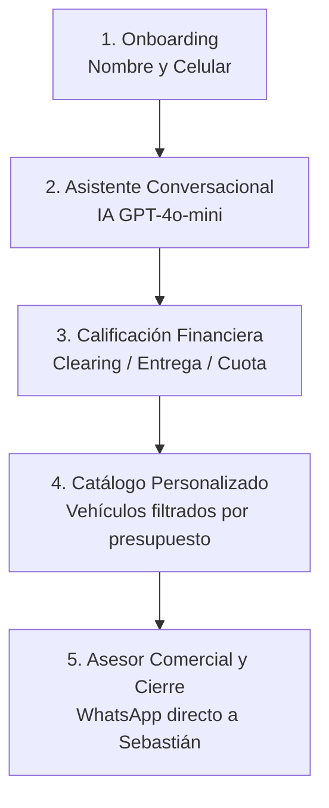

# Documentación Oficial del Proyecto: Mi Próximo Auto (Grit Automotores)

**Cliente:** Grit Automotores  
**Aplicación:** Mi Próximo Auto — Validador y Recomendador Financiero de Vehículos  
**Versión:** 1.0.0 (Beta Release)  
**Fecha:** Septiembre 2026  
**Repositorio GitHub:** [patriciolettieri052-byte/mi-proximo-auto-grit](https://github.com/patriciolettieri052-byte/mi-proximo-auto-grit.git)  
**Despliegue:** Vercel (Producción Zero-Config + Serverless)

---

## 1. Resumen Ejecutivo y Propósito

**Mi Próximo Auto** es una aplicación web interactiva desarrollada para **Grit Automotores**, concesionaria automotriz de Montevideo. Su objetivo principal es calificar financieramente a potenciales compradores de vehículos usados y 0km mediante un asistente conversacional inteligente, calculando al instante su capacidad real de pago (cuota mensual, entrega inicial y opciones crediticias) y presentándoles un catálogo personalizado con stock real y fotos de alta calidad, derivándolos directamente al asesor comercial (**Sebastián**) con el perfil pre-aprobado.

---

## 2. Identidad de Marca y Tono Conversacional

### 2.1 Identidad Institucional
- **Marca:** Grit Automotores.
- **Distintivo en Header:** Tag oficial **`Grit Automotores®`** y switch de Modo Claro / Modo Oscuro.
- **Paleta de Colores (Tokens Maestros):**
  - **Blanco Puro (`#FFFFFF`):** Fondos de cards y áreas de lectura limpia.
  - **Fondo Suave / Neutro (`#E9EAE1`):** Fondo general de la aplicación.
  - **Naranja Marca (`#F2820D`):** Acciones principales, botones de avance y destacados.
  - **Verde WhatsApp (`#25D366`):** Botones de contacto y pre-aprobación con el equipo comercial.
  - **Gris Oscuro / Carbón (`#111827`):** Textos principales y títulos.

### 2.2 Tono del Asistente Virtual
- **Estilo:** Formal, respetuoso, empático y profesional de concesionaria oficial.
- **Tratamiento:** Tuteo respetuoso uruguayo con "vos" (ej: *"¿Contás con algún monto de entrega?"*).
- **Concisión:** Respuestas y acuses de recibo breves (<= 12 palabras), evitando párrafos largos que fatiguen al usuario.
- **Límites de IA:**
  - El asistente no calcula cuotas manualmente (lo hace el motor financiero determinista en JavaScript).
  - No inventa stock ni promete excepciones en requisitos crediticios.
  - Si el usuario requiere atención humana o realiza preguntas complejas, asigna `need_human: true` y deriva formalmente al asesor comercial.

---

## 3. Flujo de Usuario y Pantallas



1. **Onboarding Inicial (`#vOnboarding`):**
   - Captura inmediata de **Nombre completo** y **Teléfono celular (WhatsApp)**.
   - Cero fricción (sin contraseñas ni códigos SMS).
   - Guarda el lead en el backend (`/api/leads`) y en `localStorage`.
2. **Diagnóstico Conversacional (`#vChat`):**
   - El asistente saluda al usuario por su nombre.
   - Extrae de manera conversacional:
     - Estado en Clearing de Informes (para definir vía bancaria o crédito de la casa).
     - Monto disponible para entrega inicial (o vehículo en permuta).
     - Presupuesto mensual disponible para la cuota.
3. **Catálogo de Autos Compatibles (`#vAutos`):**
   - Tarjetas de vehículos con fotografía real, cuota estimada calculada (en pesos y dólares), monto de entrega y requisitos crediticios.
   - Botón directo de **Pedir pre-aprobación** que deriva a la pantalla del Asesor Comercial con el vehículo ya seleccionado.
4. **Pantalla de Asesor Comercial (`#vVend`):**
   - Presenta la ficha de contacto del asesor comercial de Grit:
     - **Sebastián** (`+598 97 300 504`)
   - Resumen detallado de la calificación financiera (Clearing, Plan, Entrega, Cuota, Auto de interés).
   - Datos físicos del local: Nueva Palmira 2061 / 2064, Montevideo.

---

## 4. Motor Financiero y Reglas de Negocio

El sistema aplica la matriz financiera oficial de Grit Automotores:

| Perfil Financiero | Vía Crediticia | Entrega Requerida | Plazos Disponibles | Requisitos Clave |
| :--- | :--- | :--- | :--- | :--- |
| **Sin Clearing** | Bancaria / Tradicional | Desde 0% a 20% | Hasta 60 cuotas | Justificación de ingresos |
| **Con Clearing** | Crédito de la Casa (Grit) | Mínimo 50% | Hasta 24/36 cuotas | 2 Garantes solidarios |
| **Con Permuta** | Mixta | Tomado como parte de entrega | Según saldo | Tasación previa en local |

- **Tipo de Cambio:** Configurable dinámicamente (`UYU / USD`).
- **Moneda de Cuotas:** Presentación dual en Pesos Uruguayos ($UYU) y Dólares ($USD).

---

## 5. Inventario de Vehículos y Ruteo Comercial

- **Base de Datos de Stock:** `data/stock.json` (51 vehículos limpios de Grit Automotores `GR-...`).
- **Deduplicación:**
  - Se procesaron las publicaciones correspondientes a Grit Automotores con fotos reales en `assets/`.
- **Ruteo Comercial a WhatsApp:**
  - Configuración centralizada de asesor en `data/config.json`: **Sebastián** (`59897300504`).
  - Cada auto en `data/stock.json` cuenta con el atributo `"asesor": "sebastian"`.
  - Al solicitar pre-aprobación o permuta, el mensaje de WhatsApp se dirige a Sebastián.

---

## 6. Arquitectura Técnica y Despliegue

### 6.1 Estructura del Proyecto
```text
app-valor-cuota/
├── api/
│   ├── asistente.js     # Serverless Function: Proxy seguro con OpenAI GPT-4o-mini
│   └── leads.js         # Serverless Function: Captura y registro de leads
├── assets/              # Fotografías reales de vehículos en stock
├── css/
│   ├── app.css          # Estilos principales de componentes y vistas
│   └── tokens.css       # Variables de diseño (colores, tipografía, espaciado)
├── data/
│   ├── config.json      # Parámetros financieros y equipo comercial
│   ├── leads.json       # Almacén de prospectos capturados
│   └── stock.json       # Catálogo de vehículos con fotos y asesor asignado
├── img/
│   └── logo.png         # Isologotipo oficial de Grupo Más Autos
├── js/
│   ├── main.js          # Orquestador del ciclo de vida de la aplicación y navegación
│   ├── chat.js          # Lógica conversacional y flujo de preguntas
│   ├── finance.js       # Motor de cálculo financiero determinista
│   ├── matcher.js       # Algoritmo de compatibilidad y ranking de autos
│   ├── render.js        # Renderizado de cards de vehículos y UI
│   ├── stock.js         # Carga y filtrado del catálogo de stock
│   ├── session.js       # Manejo de sesión de usuario y storage local
│   ├── theme.js         # Control de Modo Claro / Modo Oscuro
│   └── whatsapp.js      # Generación de enlaces y mensajes a WhatsApp con asesor dinámico
├── index.html           # Single Page Application principal
├── package.json         # Configuración del proyecto
├── server.cjs           # Servidor Node.js para desarrollo local
└── DOCUMENTACION_PROYECTO.md # Documento maestro del proyecto
```

### 6.2 Integración de Inteligencia Artificial
- **Modelo:** `gpt-4o-mini` de OpenAI.
- **Seguridad:** La clave `OPENAI_API_KEY` se gestiona en variables de entorno del servidor (Vercel Serverless), sin exponer credenciales en el frontend del cliente.
- **Formato Estricto:** La API responde en formato JSON estructurado con temperatura controlada (0.6) y límite de tokens para máxima velocidad.

### 6.3 Despliegue en Producción
- **Plataforma:** Vercel Zero-Config.
- **Enrutamiento:** Archivos estáticos servidos desde la raíz y APIs serverless en `/api/*`.
- **Comando Local:** `npm start` (inicia el servidor en `http://localhost:3000`).

---

## 7. Guía de Mantenimiento

### Reasignación o Actualización de Stock
1. Modificar el archivo `data/stock.json` para agregar vehículos o cambiar el asesor asignado (`"asesor": "hernan"` o `"asesor": "sebastian"`).
2. Colocar las fotos correspondientes en la carpeta `assets/` con el nombre referenciado en el campo `foto_recorte` del JSON.
3. Hacer commit y push a la rama `main` de GitHub; Vercel actualizará el sitio automáticamente en segundos.

### Ajuste de Parámetros Financieros o Números de Contacto
- Editar `data/config.json` para modificar el tipo de cambio, las tasas de interés bancarias, o los teléfonos de Hernán y Sebastián.

---

## 8. Próximos Pasos (Fase Beta)
1. Pruebas con usuarios beta y recopilación de métricas de uso y conversión.
2. Monitoreo del balance de leads recibidos en los WhatsApps de Hernán y Sebastián.
3. Incorporación de fotografías para nuevas unidades que ingresen al inventario físico.
