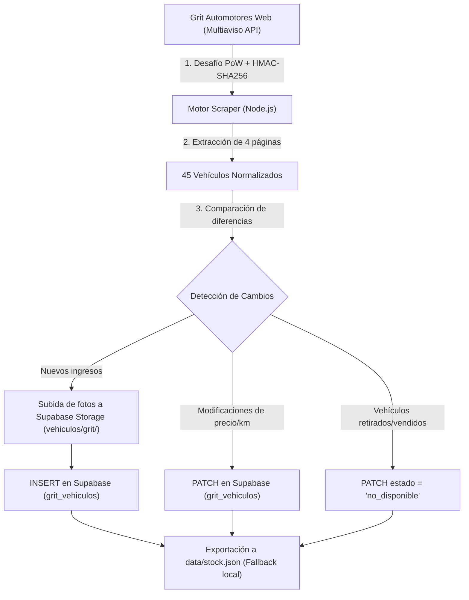

# Automatización de Actualización de Base de Datos y Stock

Este documento detalla la arquitectura, el funcionamiento técnico y las opciones disponibles para automatizar la sincronización periódica del catálogo de vehículos de **Grit Automotores** con **Supabase** y la aplicación web **Mi Próximo Auto**.

> [!NOTE]
> Este proceso se encuentra documentado para su posterior implementación. Actualmente el script de sincronización se ejecuta de manera manual o bajo demanda.

---

## 1. Arquitectura del Pipeline de Sincronización

El flujo de actualización toma los vehículos publicados en el portal oficial y los sincroniza en la base de datos en la nube y el respaldo local.



### Componentes Clave
1. **Origen de Datos:** API de Multiaviso v4 (`https://automotora.multiaviso.com/plugin/v4/list`).
   - Requiere resolución de prueba de trabajo (*Proof of Work* con hash SHA-256) vía `/plugin/v4/bg/challenge` y `/plugin/v4/bg/verify` para obtener el `X-BG-Token`.
   - Requiere firma criptográfica HMAC-SHA256 en base al `client` (`82K2QBEBGTD5LG`) y la marca de tiempo UTC.
2. **Base de Datos Cloud (Supabase):**
   - **Tabla:** `grit_vehiculos` (PostgreSQL).
   - **Bucket de Fotos:** `vehiculos/grit/` (almacenamiento CDN público).
3. **Respaldo Local / Serverless:**
   - Archivo [`data/stock.json`](file:///c:/Users/matil/OneDrive/Desktop/Bamba%20Scale/Grit%20App%20Mi%20proximo%20Auto/data/stock.json), consumido por la aplicación como fallback instantáneo ante cortes de conectividad.

---

## 2. Opciones de Automatización para el Futuro

### Opción A: GitHub Actions (Recomendada)

Permite programar la ejecución del script Node.js en los servidores de GitHub sin costo y sin consumir cuotas de base de datos.

#### Archivo a crear: `.github/workflows/sync-stock.yml`

```yaml
name: Sincronizar Stock Grit Automotores

on:
  schedule:
    # Se ejecuta todos los días a las 06:00 y a las 18:00 UTC (03:00 y 15:00 hora Uruguay)
    - cron: '0 6,18 * * *'
  workflow_dispatch: # Permite ejecutarlo manualmente desde GitHub con un clic

jobs:
  sync:
    runs-on: ubuntu-latest
    steps:
      - name: Clonar repositorio
        uses: actions/checkout@v4

      - name: Configurar Node.js
        uses: actions/setup-node@v4
        with:
          node-version: '20'

      - name: Ejecutar script de sincronización
        env:
          SUPABASE_URL: ${{ secrets.SUPABASE_URL }}
          SUPABASE_SERVICE_ROLE_KEY: ${{ secrets.SUPABASE_SERVICE_ROLE_KEY }}
        run: |
          node scripts/sync_stock.cjs

      - name: Confirmar y subir cambios a data/stock.json si hubo modificaciones
        run: |
          git config user.name "github-actions[bot]"
          git config user.email "github-actions[bot]@users.noreply.github.com"
          git add data/stock.json
          git diff --quiet && git diff --staged --quiet || (git commit -m "Automated: Actualización de stock de vehículos" && git push)
```

#### Ventajas:
- **Costo cero:** 2.000 minutos mensuales gratuitos en repositorios públicos/privados.
- Resuelve naturalmente el algoritmo Proof-of-Work y sube las imágenes binarias a Supabase Storage sin restricciones de memoria o timeout.
- Mantiene sincronizado el repositorio de GitHub con los últimos cambios de `data/stock.json`.

---

### Opción B: Cronjob Nativo en Supabase (`pg_cron` + `pg_net`)

Supabase cuenta con la extensión `pg_cron` para programar tareas dentro de la base de datos PostgreSQL.

#### 1. Mantenimiento Interno en Base de Datos
Para tareas que solo manipulan datos dentro de PostgreSQL (por ejemplo, purga de leads antiguos o control de reservas):

```sql
-- Activar la extensión
CREATE EXTENSION IF NOT EXISTS pg_cron;

-- Programar ejecución diaria
SELECT cron.schedule(
  'mantenimiento-leads',
  '0 3 * * *',
  $$ UPDATE grit_leads SET notas = 'archivado' WHERE created_at < NOW() - INTERVAL '180 days'; $$
);
```

#### 2. Disparar una Edge Function Externa
Para procesos más complejos que requieren peticiones web (como scrapear), `pg_cron` se combina con `pg_net`:

```sql
CREATE EXTENSION IF NOT EXISTS pg_net;

SELECT cron.schedule(
  'trigger-sync-stock',
  '0 */12 * * *', -- Cada 12 horas
  $$
  SELECT net.http_post(
    url := 'https://tyywkunwrdgtxslrqxox.supabase.co/functions/v1/sync-stock',
    headers := jsonb_build_object(
      'Content-Type', 'application/json',
      'Authorization', 'Bearer ' || current_setting('app.settings.service_role_key', true)
    ),
    body := '{}'::jsonb
  );
  $$
);
```

> [!WARNING]
> Las Edge Functions de Supabase tienen un límite de tiempo de ejecución (wall-clock limit) de 150 segundos. Si el catálogo crece a cientos de autos con subida pesada de fotos, podría requerir procesamiento en lotes o un runner como GitHub Actions.

---

### Opción C: Vercel Cron Jobs

Si la aplicación está desplegada en Vercel, se puede configurar un Cron Job que invoque un endpoint serverless en `/api/cron/sync`.

#### Configuración en `vercel.json`:
```json
{
  "crons": [
    {
      "path": "/api/cron-sync",
      "schedule": "0 8 * * *"
    }
  ]
}
```

---

## 3. Variables de Entorno Requeridas

Cuando se decida activar la automatización, las siguientes variables deben estar configuradas en los secretos de la plataforma elegida (GitHub Secrets, Supabase Vault o Vercel Environment Variables):

| Variable | Descripción |
| :--- | :--- |
| `SUPABASE_URL` | URL base del proyecto (`https://tyywkunwrdgtxslrqxox.supabase.co`) |
| `SUPABASE_SERVICE_ROLE_KEY` | Clave secreta con permisos de lectura/escritura en Storage y PostgreSQL |
| `MULTIAVISO_CLIENT` | Identificador del cliente de Grit Automotores (`82K2QBEBGTD5LG`) |

---

## 4. Pasos para la Activación Futura

Cuando se desee poner en marcha la sincronización automática:
1. Mover el script [`scratch/sync_stock.cjs`](file:///c:/Users/matil/OneDrive/Desktop/Bamba%20Scale/Grit%20App%20Mi%20proximo%20Auto/scratch/sync_stock.cjs) a una carpeta permanente como `scripts/sync_stock.cjs`.
2. Crear el workflow `.github/workflows/sync-stock.yml` (Opción A).
3. Configurar en **GitHub ➔ Settings ➔ Secrets and variables ➔ Actions** los valores de `SUPABASE_URL` y `SUPABASE_SERVICE_ROLE_KEY`.
4. El workflow comenzará a correr según el cron definido y actualizará Supabase y GitHub automáticamente.
