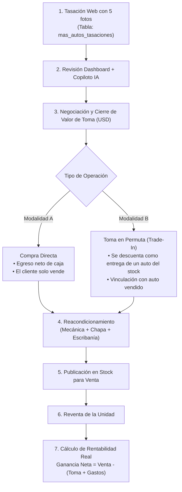

# REGISTRO DE DECISIONES DE ARQUITECTURA Y NEGOCIO (ADR & BUSINESS LOGIC)
> **MÁS AUTOS (+AUTOS) — SISTEMA DE TASACIÓN, PERMUTAS Y RENTABILIDAD**  
> *Este documento establece la lógica de negocio, el modelo de datos para la trazabilidad completa del usado (desde la tasación web hasta su reventa final) y el cálculo de ganancia real.*

---

## 1. Decisión de Negocio: Las Dos Vías de Ingreso (Compra Directa vs. Permuta)

Un vehículo tasado en la web que es aceptado por el equipo comercial de Más Autos ingresa al negocio a través de una de dos modalidades financieras:



### Modalidad A: Compra Directa (Cash Buy)
- **Flujo:** El cliente solo busca liquidez y no compra otro auto en la automotora.
- **Financiero:** Representa una salida de caja pura para Más Autos por el `valor_toma_usd`.

### Modalidad B: Toma en Permuta (Trade-In / Llave contra Llave)
- **Flujo:** El cliente entrega su usado como parte de pago de una unidad del stock de Más Autos.
- **Financiero:**
  - El `valor_toma_usd` cubre total o parcialmente la entrega inicial requerida.
  - La diferencia restante se abona al contado o mediante financiación (Crédito Bancario o Crédito de la Casa).
  - **Trazabilidad doble:** El sistema debe registrar tanto el vehículo que entra (`auto_tomado`) como el vehículo que sale del stock (`auto_vendido_id`).

---

## 2. Nueva Tabla en Base de Datos: `mas_autos_operaciones`

Para no mezclar solicitudes web de curiosos con operaciones comerciales reales y costos de taller, se desacopla la tabla de solicitudes (`mas_autos_tasaciones`) de la tabla de **trazabilidad física, financiera y contable** (`mas_autos_operaciones`):

```sql
CREATE TABLE public.mas_autos_operaciones (
    id UUID PRIMARY KEY DEFAULT gen_random_uuid(),
    created_at TIMESTAMPTZ DEFAULT NOW(),
    updated_at TIMESTAMPTZ DEFAULT NOW(),

    -- Vinculación con la tasación web inicial (opcional si entró por salón directo)
    tasacion_id UUID REFERENCES public.mas_autos_tasaciones(id) ON DELETE SET NULL,

    -- Identificación de la unidad
    matricula VARCHAR(15) NOT NULL,
    marca VARCHAR(60) NOT NULL,
    modelo VARCHAR(100) NOT NULL,
    anio SMALLINT NOT NULL,
    km_ingreso INTEGER NOT NULL,

    -- Modalidad de Adquisición
    tipo_adquisicion VARCHAR(20) NOT NULL CHECK (tipo_adquisicion IN ('compra_directa', 'permuta')),
    auto_vendido_id VARCHAR(100) NULL,      -- ID del auto del stock vendido (si fue permuta)
    cliente_nombre VARCHAR(100) NOT NULL,
    cliente_telefono VARCHAR(30) NOT NULL,
    fecha_ingreso DATE NOT NULL DEFAULT CURRENT_DATE,

    -- Estructura de Costos de Adquisición y Taller (USD)
    valor_toma_usd NUMERIC(10,2) NOT NULL,           -- Monto reconocido al cliente
    gastos_mecanica_usd NUMERIC(10,2) DEFAULT 0.00,  -- Service, frenos, distribución, etc.
    gastos_chapa_pintura_usd NUMERIC(10,2) DEFAULT 0.00, -- Bollos, repintado, pulido
    gastos_estetica_usd NUMERIC(10,2) DEFAULT 0.00,  -- Lavado de tapizados, detailing
    gastos_escribania_usd NUMERIC(10,2) DEFAULT 0.00,-- Títulos, transferencias, certificados

    -- Costo Total Acumulado (Columna calculada / generada)
    costo_total_acumulado_usd NUMERIC(10,2) GENERATED ALWAYS AS (
        valor_toma_usd + gastos_mecanica_usd + gastos_chapa_pintura_usd + gastos_estetica_usd + gastos_escribania_usd
    ) STORED,

    -- Comercialización y Salida
    precio_publicado_usd NUMERIC(10,2) NULL,        -- Precio de lista en vidriera
    fecha_venta DATE NULL,                          -- Fecha en que se firmó la venta
    precio_venta_final_usd NUMERIC(10,2) NULL,      -- Precio real acordado con el comprador
    forma_pago_salida VARCHAR(30) NULL,             -- 'contado', 'financiado_banco', 'financiado_casa', 'otra_permuta'

    -- Liquidación de Rentabilidad (Calculada al concretarse la venta)
    ganancia_neta_usd NUMERIC(10,2) GENERATED ALWAYS AS (
        CASE WHEN precio_venta_final_usd IS NOT NULL 
             THEN precio_venta_final_usd - (valor_toma_usd + gastos_mecanica_usd + gastos_chapa_pintura_usd + gastos_estetica_usd + gastos_escribania_usd)
             ELSE NULL 
        END
    ) STORED,

    margen_porcentaje NUMERIC(6,2) GENERATED ALWAYS AS (
        CASE WHEN precio_venta_final_usd IS NOT NULL AND (valor_toma_usd + gastos_mecanica_usd + gastos_chapa_pintura_usd + gastos_estetica_usd + gastos_escribania_usd) > 0
             THEN ((precio_venta_final_usd - (valor_toma_usd + gastos_mecanica_usd + gastos_chapa_pintura_usd + gastos_estetica_usd + gastos_escribania_usd)) / (valor_toma_usd + gastos_mecanica_usd + gastos_chapa_pintura_usd + gastos_estetica_usd + gastos_escribania_usd)) * 100
             ELSE NULL 
        END
    ) STORED,

    dias_en_stock INTEGER GENERATED ALWAYS AS (
        CASE WHEN fecha_venta IS NOT NULL 
             THEN fecha_venta - fecha_ingreso 
             ELSE NULL 
        END
    ) STORED,

    -- Estado del Ciclo de Vida
    estado_unidad VARCHAR(30) DEFAULT 'en_alistamiento' CHECK (
        estado_unidad IN ('en_alistamiento', 'disponible_salon', 'seniado', 'vendido', 'baja')
    ),

    vendedor_toma VARCHAR(60) NOT NULL,             -- Quién tasó/tomó el auto
    vendedor_venta VARCHAR(60) NULL,                -- Quién lo vendió finalmente
    observaciones TEXT NULL
);

-- Índices de consulta rápida
CREATE INDEX idx_operaciones_estado ON public.mas_autos_operaciones (estado_unidad);
CREATE INDEX idx_operaciones_fechas ON public.mas_autos_operaciones (fecha_ingreso DESC, fecha_venta DESC);
CREATE INDEX idx_operaciones_tasacion ON public.mas_autos_operaciones (tasacion_id);
```

---

## 3. Lógica de Trazabilidad del Negocio (Paso a Paso)

```text
[Cliente Web]              [Vendedor / Dashboard]                [Taller / Administración]           [Venta Final]
     │                               │                                       │                             │
  1. Envía 5 fotos ─────────> 2. Evalúa con IA                               │                             │
     y ficha técnica            y pacta toma (USD)                           │                             │
                                     │                                       │                             │
                              3. Inserta registro                            │                             │
                                 en 'operaciones'                            │                             │
                                 (Tipo: Compra o Permuta)                    │                             │
                                     │                                       │                             │
                                     └────────────────────────────────> 4. Se cargan facturas              │
                                                                           de taller y escribanía          │
                                                                           (Costos acumulados)             │
                                                                                     │                     │
                                                                        5. Pasa a 'disponible_salon'       │
                                                                                     │                     │
                                                                                     └──────────────> 6. Se vende
                                                                                                         Se ingresa fecha
                                                                                                         y precio_venta
                                                                                                               │
                                                                                                      7. CÁLCULO EN VIVO:
                                                                                                         • Ganancia USD
                                                                                                         • Margen %
                                                                                                         • Días en Stock
```

---

## 4. Métricas Clave de Negocio para Más Autos (KPIs en Dashboard)

Con esta tabla, el Dashboard comercial de Más Autos puede responder con 1 clic preguntas estratégicas del negocio:

1. **Spread y Precisión del Tasador / IA:**
   - ¿Qué valor sugirió el Asistente de IA originalmente?
   - ¿A cuánto lo tomó el vendedor en la realidad?
   - Si una unidad dio pérdida o tardó 120 días en venderse, ¿se sobrevaluó en la toma?
2. **Costo Oculto de Taller:**
   - Cuánto dinero promedio se le invierte a cada usado en Montevideo para dejarlo en condiciones de vidriera (`mecanica + chapa + estetica`).
3. **Rentabilidad por Modalidad (Compra Directa vs. Permuta):**
   - Comparación del margen neto: ¿Es más rentable salir a comprar autos directamente con liquidez o tomarlos en permutas facilitando la venta de unidades más caras?
4. **Velocidad de Rotación (Días en Stock):**
   - Detección de autos "clavados" (+60 días) que erosionan el capital de trabajo de la automotora.

---

## 5. Retroalimentación hacia el Asistente de IA (Machine Learning Feedback Loop)

Gracias a la columna `tasacion_id` que conecta ambas tablas, el **Copiloto de IA de Más Autos se vuelve más inteligente con el tiempo**:

Cuando un vendedor consulte por un *Gol Trend 2018 con 90.000 km*, la IA podrá consultar en segundo plano la tabla `mas_autos_operaciones` y responder:
> *"Atención vendedor: En los últimos 6 meses Más Autos tomó 3 Gol Trend similares a USD 8.800 promedio. Tuvieron un gasto de taller de USD 450 y se vendieron en un promedio de 22 días a USD 10.900, arrojando una ganancia limpia de USD 1.650 (17.7% de margen). Se recomienda no tomar por encima de USD 9.000 para preservar el margen."*

---

## 6. Decisión de Arquitectura y UX: Dashboard Desktop-First en Pantalla Dividida (Split Screen)

### Contexto y Justificación:
Los tasadores y vendedores comerciales de Más Autos trabajan principalmente desde sus puestos de venta físicos (desktops o notebooks) mientras utilizan WhatsApp Web y consultan portales de mercado. Diseñar un dashboard puramente móvil limitaría la productividad y la visualización simultánea de fotos en alta resolución.

### Arquitectura de Pantalla Dividida (2 Módulos Lado a Lado):

```text
┌────────────────────────────────────────┬────────────────────────────────────────┐
│      MÓDULO IZQUIERDO (45%)            │        MÓDULO DERECHO (55%)            │
│  COPILOTO IA CON VISIÓN Y ACCESO A DB  │  CATÁLOGO DE AUTOS TASADOS (DB)        │
├────────────────────────────────────────┼────────────────────────────────────────┤
│ • Chat interactivo en tiempo real      │ • Filtros rápidos: [Pendientes] [Todos]│
│ • Visión Computacional (GPT-4o Vision):│ • Ficha de la unidad seleccionada:     │
│   - Detecta bollos, rayas, pintura     │   - Marca, Modelo, Año, Kilometraje    │
│   - Desgaste visible en volante/asiento│   - Tira interactiva de las 5 fotos    │
│ • Acceso a Base de Datos (Tools/SQL):  │ • Input interactivo del vendedor:      │
│   - Histórico de compra/venta en DB    │   [ USD  | Precio Tasado           ]   │
│   - Margen proyectado de Más Autos     │ • Botón de confirmación:               │
│ • Redacción en vivo de propuesta WA    │   [ ✓ Confirmar Tasación           ]   │
│                                        │ • Botón: [ 💬 Abrir WhatsApp Web ]    │
└────────────────────────────────────────┴────────────────────────────────────────┘
```

### Mecánica Operativa del Vendedor:
1. **Selección del Auto (Derecha):** El vendedor hace clic en una solicitud pendiente del catálogo. Se cargan los datos y la galería de 5 fotos.
2. **Auditoría Automática de la IA (Izquierda):** En el chat del copiloto, la IA ejecuta su análisis multimodal sobre las 5 fotos y cruza la información con la tabla `mas_autos_operaciones`.
3. **Diálogo Interactivo:** El vendedor puede repreguntar en el chat: *"¿Ves algún detalle en el lateral derecho?", "¿Tenemos mucho stock de este modelo?", "¿A cuánto cerramos el último similar?"*.
4. **Fijación del Precio:** El vendedor digita el monto acordado en el campo `"Precio Tasado"` y pulsa `"Confirmar tasación"`.
5. **Impacto en DB y Cierre:** El sistema actualiza `mas_autos_tasaciones` con el monto y el estado `cotizado`, y genera el botón para disparar el mensaje de WhatsApp al cliente.
