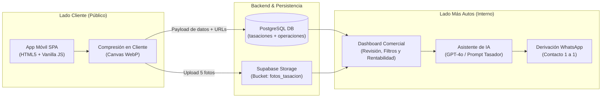
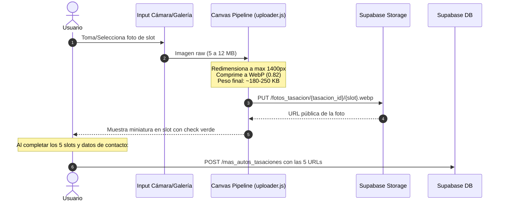

# ARQUITECTURA DEL SISTEMA: APP DE TASACIONES (MÁS AUTOS)
> **DOCUMENTO MAESTRO DE ARQUITECTURA TÉCNICA**  
> *Define la estructura de componentes, almacenamiento, base de datos, funciones serverless y el ecosistema híbrido entre la App pública de captación y el Dashboard comercial asistido por IA.*

---

## 1. Visión General del Sistema

El sistema tiene como objetivo captar vehículos usados de clientes potenciales mediante un embudo de tasación guiado, almacenar sus especificaciones y 5 fotos obligatorias, y disponibilizar toda la información en un **Dashboard interno** equipado con un **Asistente de IA** que asiste al equipo de ventas de **Más Autos** en la revisión, tasación y contacto comercial.



---

## 2. Stack Tecnológico

| Capa | Tecnología | Justificación |
| :--- | :--- | :--- |
| **Frontend Público** | Vanilla JavaScript (ES6+), HTML5, CSS Tokens | Cero tiempo de compilación, carga instantánea (<1s en 4G), mantenimiento simple sin dependencias frágiles. |
| **Diseño / Estilos** | CSS Custom Properties (`tokens.css`, `app.css`) | Reutilización total del sistema visual probado de la app de valor cuota (Look nativo móvil en contenedor de 480px). |
| **Almacenamiento** | Supabase Storage (`fotos_tasacion`) | Almacenamiento seguro en CDN para las 5 fotos obligatorias con subida directa o vía token. |
| **Base de Datos** | Supabase PostgreSQL (`mas_autos_tasaciones` + `mas_autos_operaciones`) | Tablas desacopladas para solicitudes web y para trazabilidad contable, costos de taller y rentabilidad real. |
| **Backend Serverless** | Vercel Functions (`/api/*.js`) | Endpoints Node.js ligeros para procesamiento seguro de IA, guardado y tokenización sin exponer claves maestras. |
| **Asistente de IA** | OpenAI API (`gpt-4o-mini` / `gpt-4o`) | Análisis de coherencia de la unidad, estimación de rango de mercado y redacción de propuestas personalizadas para el vendedor. |

---

## 3. Estructura de Directorios del Proyecto

```text
app-tasacion-mas-autos/
├── api/
│   ├── tasacion.js              # Endpoint serverless: Validación y guardado en DB
│   └── asistente-tasacion.js    # Endpoint serverless: Copiloto de IA para el Dashboard
├── css/
│   ├── tokens.css               # Design tokens (colores Más Autos, tipografías, radios)
│   ├── app.css                  # Estilos del contenedor móvil, chat y uploader
│   └── dashboard.css            # Estilos del panel interno del vendedor
├── js/
│   ├── main.js                  # Inicializador y router SPA (pantallas del usuario)
│   ├── chat.js                  # Máquina de estados conversacional (4 preguntas del auto)
│   ├── uploader.js              # Manejo de los 5 slots de fotos, compresión en canvas y upload
│   ├── session.js               # Estado reactivo local de la tasación en curso
│   └── supabase.js              # Cliente ligero de conexión con Supabase (DB + Storage)
├── dashboard/
│   ├── index.html               # Panel interno de Más Autos para el equipo de ventas
│   └── dashboard.js             # Lógica de listado, visualizador de fotos y asistente IA
├── documentacion/
│   ├── arquitectura.md          # Este documento
│   ├── flow.md                  # Flujo detallado del usuario y del vendedor
│   ├── specs.md                 # Modelo de datos, especificaciones de fotos y prompt IA
│   └── DECISIONS.md             # Trazabilidad de compra directa/permuta y rentabilidad real
├── index.html                   # SPA pública de captación (cliente)
└── vercel.json                  # Configuración de rutas y variables serverless
```

---

## 4. Arquitectura de Almacenamiento de Fotos (Client-Side Pipeline)

Para garantizar que un usuario desde un celular en la calle no agote su plan de datos ni enfrente errores de tiempo de espera al subir 5 fotos de alta resolución (que pueden pesar 8 MB cada una en su cámara original), la arquitectura implementa una **tubería de compresión en el cliente antes de la subida**:



### Reglas de Storage en Supabase:
- **Bucket:** `fotos_tasacion` (Acceso público de lectura para el dashboard, subida anónima o firmada).
- **Ruta estructurada:** `{tasacion_id}/{slot}.webp`
  - Ejemplo: `TAS-2026-0925-01/frente.webp`
  - Ejemplo: `TAS-2026-0925-01/trasera.webp`
  - Ejemplo: `TAS-2026-0925-01/lateral_izq.webp`
  - Ejemplo: `TAS-2026-0925-01/lateral_der.webp`
  - Ejemplo: `TAS-2026-0925-01/interior.webp`

---

## 5. Arquitectura del Dashboard Interno (Desktop-First Split Screen) & Copiloto IA

El Dashboard opera como una aplicación web protegida para los vendedores de Más Autos, diseñada bajo un paradigma **Desktop-First en pantalla dividida (2 módulos paralelos)**:

1. **Módulo Derecho (55% - Gestión Operativa y Catálogo de Tasaciones):**
   - Conexión en tiempo real con Supabase (`mas_autos_tasaciones`).
   - Tira interactiva de las **5 fotos** con visor modal para inspección humana.
   - **Input interactivo de acción comercial:** Campo `"Precio Tasado USD"` (inicialmente en blanco).
   - **Botón "Confirmar Tasación":** Guarda la decisión del tasador en la base de datos, marca la solicitud como `cotizado` y activa el disparador directo a WhatsApp Web.

2. **Módulo Izquierdo (45% - Copiloto IA Multimodal con Visión y DB Tools):**
   - **Visión Computacional (GPT-4o Vision):** Consume las 5 URLs públicas alojadas en Supabase Storage (`fotos_tasacion/{id}/*.webp`), analizando daños en chapa/paragolpes y desgaste del habitáculo.
   - **Acceso a Base de Datos (Tools/Function Calling):** Consulta en tiempo real la tabla `mas_autos_operaciones` para recuperar márgenes históricos, costos típicos de taller para esa marca/modelo y velocidad de venta en días.
   - **Chat Conversacional Continuo:** El vendedor puede repreguntar en lenguaje natural antes de confirmar el precio en el módulo derecho.
   - **Generador de Mensaje:** Redacta la propuesta formal con tono comercial Más Autos para enviar al cliente por WhatsApp con un solo clic.

---

## 6. Seguridad y Variables de Entorno

- **`SUPABASE_URL`:** URL base del proyecto en Supabase.
- **`SUPABASE_ANON_KEY`:** Clave anónima pública con políticas de Row Level Security (RLS) limitadas a inserción en `mas_autos_tasaciones` y upload en `fotos_tasacion`.
- **`SUPABASE_SERVICE_ROLE_KEY`:** Clave administrativa utilizada exclusivamente en endpoints serverless (`/api/`) para lectura/actualización del dashboard.
- **`OPENAI_API_KEY`:** Clave privada de OpenAI consumida únicamente en el servidor serverless sin exposición en el cliente.
