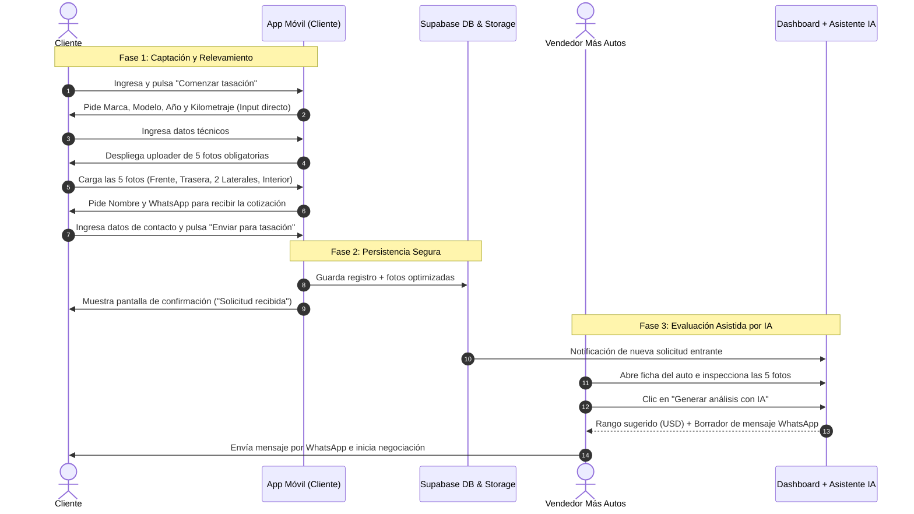
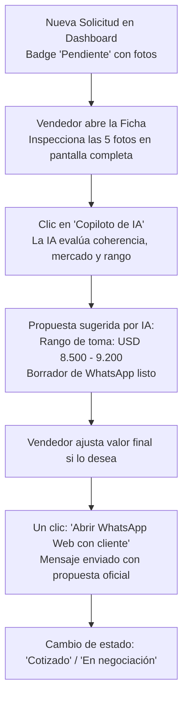

# FLUJO DE EXPERIENCIA Y USUARIO: APP DE TASACIONES (MÁS AUTOS)
> **DOCUMENTO MAESTRO DE UX & EMBEDDED CHAT FUNNEL**  
> *Describe la interacción paso a paso del usuario en la app móvil, el comportamiento del cargador de 5 fotos y el posterior flujo operativo del vendedor dentro del dashboard asistido por IA.*

---

## 1. Mapa de Flujo de Extremo a Extremo (Ecosystem Journey)



---

## 2. Flujo del Usuario en la App Pública (Lado Cliente)

La experiencia del usuario es **100% mobile-first, sin distracciones, sin chips innecesarios y sin formularios pesados**:

### Paso 0: Pantalla de Bienvenida (Intro Hero)
- **Título de impacto:** *"¿Querés vender o entregar tu auto en permuta? Tasalo hoy en Más Autos"*
- **Subtítulo:** *"Recibí una cotización real de nuestro equipo en pocos minutos. Solo necesitás los datos de tu auto y 5 fotos."*
- **Badges de confianza:**
  - Salón de ventas propio en Montevideo.
  - Cotización formal respaldada por Más Autos.
  - Tomamos tu auto como parte de pago o te lo compramos directo.
- **Acción:** Botón primario *"Comenzar tasación"* ➔ Pasa inmediatamente a la vista conversacional.

---

### Paso 1: Relevamiento Técnico del Vehículo (Chat Guiado)
El asistente formula las preguntas de forma secuencial en el chat. El usuario responde tipeando directamente en el campo de texto inferior, que adapta su comportamiento:

1. **Pregunta 1 (Marca):**
   - *Asistente:* *"¡Hola! Vamos a tasar tu vehículo. Para empezar, ¿cuál es la marca de tu auto?"*
   - *Input:* Teclado de texto libre con capitalización automática.
   - *Ejemplo usuario:* `Volkswagen`
2. **Pregunta 2 (Modelo y Versión):**
   - *Asistente:* *"Bien, un Volkswagen. ¿Cuál es el modelo y versión?"*
   - *Input:* Texto libre (placeholder: *"Ej. Gol Trend 1.6 Highline"*).
   - *Ejemplo usuario:* `Gol Trend 1.6`
3. **Pregunta 3 (Año):**
   - *Asistente:* *"¿De qué año es la unidad?"*
   - *Input:* Teclado numérico móvil (`input type="number"`), validado entre 1980 y el año corriente.
   - *Ejemplo usuario:* `2018`
4. **Pregunta 4 (Kilometraje):**
   - *Asistente:* *"¿Cuántos kilómetros tiene aproximadamente al día de hoy?"*
   - *Input:* Teclado numérico con formateo de miles automático.
   - *Ejemplo usuario:* `95.000 km`

---

### Paso 2: El Uploader de 5 Fotos Obligatorias
El asistente envía un mensaje introductorio y renderiza el componente visual interactivo:

> *Asistente:* *"Excelente. Para que nuestro equipo evalúe el estado de chapa, pintura y tapizado, necesitamos obligatoriamente estas 5 fotos de tu auto:"*

```text
┌─────────────────────────────────────────────────────────┐
│              📸 5 FOTOS OBLIGATORIAS                    │
├────────────────────────────┬────────────────────────────┤
│ [ 📷 ] 1. Frente           │ [ 📷 ] 2. Trasera          │
│ Vista delantera completa   │ Vista trasera con matrícula│
├────────────────────────────┼────────────────────────────┤
│ [ 📷 ] 3. Lateral Izq.     │ [ 📷 ] 4. Lateral Der.     │
│ Lado del conductor         │ Lado del acompañante       │
├────────────────────────────┴────────────────────────────┤
│ [ 📷 ] 5. Interior                                      │
│ Tablero, volante y tapizado delantero                   │
└─────────────────────────────────────────────────────────┘
  [ Botón: Continuar (Deshabilitado hasta tener las 5 fotos) ]
```

#### Comportamiento UX de cada Slot:
- **Estado Inicial (Vacío):** Borde punteado, icono de cámara y nombre del ángulo requerido.
- **Acción al Tocar:** Abre el selector nativo del celular (permite tomar foto con la cámara en el momento o elegir de la galería).
- **Compresión inmediata:** En cuanto se selecciona la imagen, el pipeline local la procesa en milisegundos.
- **Estado Completo:** Muestra la miniatura de la foto recortada en relación 4:3 con un tilde verde (`✓`) y un botón circular `x` en la esquina superior para reemplazarla si el usuario no quedó conforme.
- **Validación estricta:** El botón *"Continuar a datos de contacto"* solo se activa cuando los **5 casilleros** están completos.

---

### Paso 3: Datos de Contacto (Cierre del Embudo)
Una vez cargadas las fotos, el usuario tiene un alto nivel de inversión emocional y temporal en el proceso. Aquí se le solicita su contacto de forma transparente:

> *Asistente:* *"¡Fotos listas! Por último, ¿a qué nombre y número de WhatsApp te enviamos la tasación estimada?"*

- **Campo 1:** Nombre completo (ej. *"Ignacio Rodríguez"*).
- **Campo 2:** Teléfono celular uruguayo (ej. *"099 123 456"* con validación de prefijo `09`).
- **Botón de Envío:** *"Enviar solicitud de tasación"* (con icono de candado y leyenda *"Tus datos solo se usarán para enviarte la cotización"*).

---

### Paso 4: Pantalla de Confirmación (Success Screen)
A diferencia de otros embudos, **aquí no se fuerza al usuario a saltar a WhatsApp**. La app guarda los datos en Supabase y le presenta una pantalla de confirmación limpia y tranquilizadora:

- **Icono de éxito:** Check verde animado.
- **Título:** *"¡Solicitud de tasación enviada con éxito!"*
- **Resumen visual:**
  - Ficha: `Volkswagen Gol Trend 1.6 (2018) · 95.000 km`
  - 5 fotos adjuntas correctamente.
  - Código de referencia único: `#TAS-9482`
- **Mensaje de tranquilidad:** *"Nuestro equipo de tasadores en Más Autos ya tiene toda la información. Analizaremos tu unidad y te escribiremos directamente a tu WhatsApp (**099 123 456**) con la propuesta."*
- **Botón secundario:** *"Volver al inicio"* o enlace directo al catálogo si también busca cambiar de auto.

---

## 3. Flujo Operativo del Vendedor (Lado Más Autos)

El flujo de trabajo del equipo comercial se centraliza en el **Dashboard de Tasaciones**:



1. **Recepción:** El dashboard actualiza en tiempo real la lista de unidades pendientes ordenadas por fecha/hora de ingreso.
2. **Inspección rápida:** El vendedor hace clic en la fila del vehículo y se abre un panel lateral con los datos técnicos y una galería con las **5 fotos** en alta calidad para revisar golpes, rayones o desgaste del interior.
3. **Consulta al Copiloto IA:**
   - El vendedor presiona el botón *"Analizar con Asistente IA"*.
   - La IA compara los datos de año, km y estado aparente, sugiriendo un **rango de compra mayorista/permuta** realista para el mercado uruguayo.
4. **Respuesta comercial con un toque:**
   - El dashboard muestra un cuadro de texto con el mensaje pre-redactado por la IA.
   - El vendedor puede modificar la cifra o enviar directamente haciendo clic en el botón verde *"Contactar por WhatsApp"*, el cual abre WhatsApp Web o la app nativa con el chat del cliente abierto y el mensaje listo para enviar.
