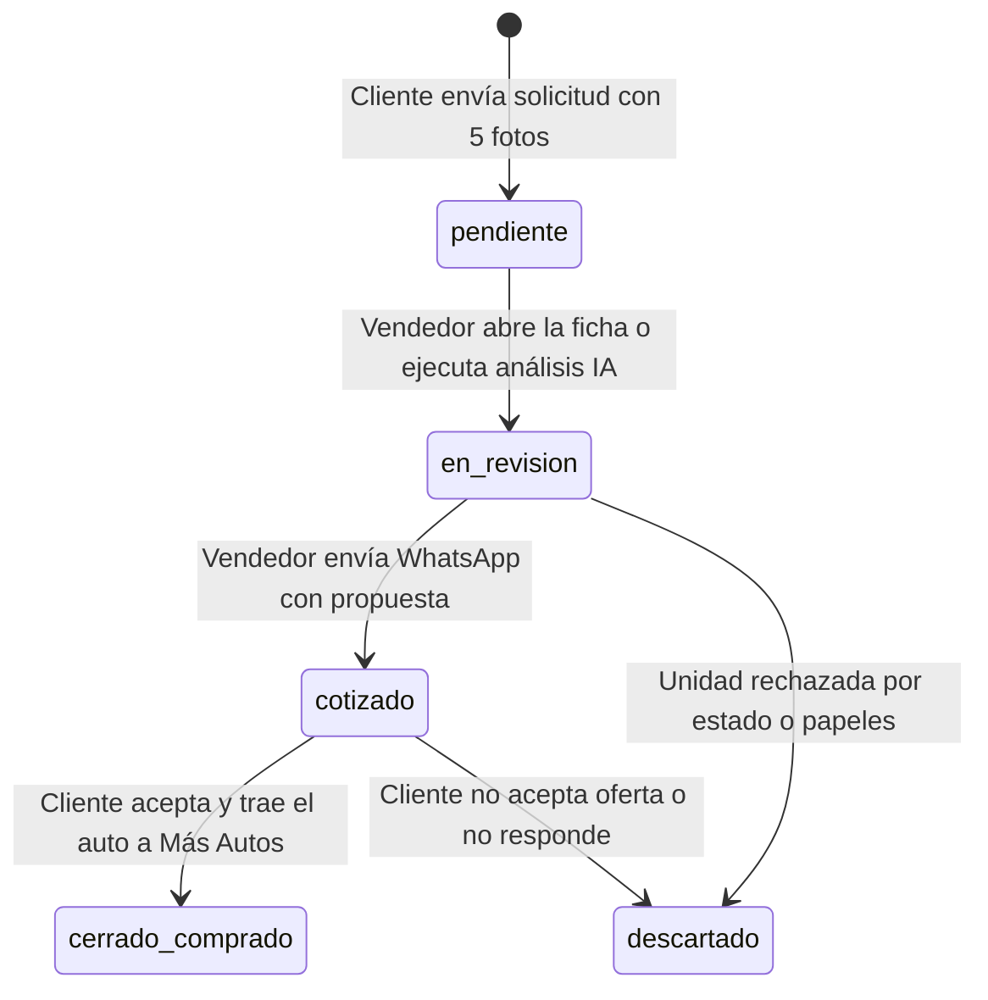

# ESPECIFICACIONES TÉCNICAS Y REGLAS DE NEGOCIO: APP DE TASACIONES (MÁS AUTOS)
> **DOCUMENTO MAESTRO DE ESPECIFICACIONES (SPECS)**  
> *Define el modelo de datos exacto, las reglas de validación de campos, los parámetros del cargador de imágenes y el esquema del Asistente de IA para el Dashboard comercial.*

---

## 1. Modelo de Datos (Base de Datos Supabase)

### Tabla Principal: `mas_autos_tasaciones`

```sql
CREATE TABLE public.mas_autos_tasaciones (
    id UUID PRIMARY KEY DEFAULT gen_random_uuid(),
    codigo_ref VARCHAR(20) NOT NULL UNIQUE,          -- Ej: 'TAS-2026-9482'
    created_at TIMESTAMPTZ DEFAULT NOW(),
    updated_at TIMESTAMPTZ DEFAULT NOW(),

    -- Datos del Prospecto
    nombre VARCHAR(100) NOT NULL,
    telefono VARCHAR(30) NOT NULL,

    -- Especificaciones Obligatorias del Auto
    marca VARCHAR(60) NOT NULL,
    modelo VARCHAR(100) NOT NULL,
    anio SMALLINT NOT NULL,
    km INTEGER NOT NULL,

    -- Las 5 Fotos Obligatorias (URLs CDN de Supabase Storage)
    foto_frente TEXT NOT NULL,
    foto_trasera TEXT NOT NULL,
    foto_lateral_izq TEXT NOT NULL,
    foto_lateral_der TEXT NOT NULL,
    foto_interior TEXT NOT NULL,

    -- Gestión Comercial y Asistente IA
    estado VARCHAR(30) DEFAULT 'pendiente',          -- 'pendiente', 'en_revision', 'cotizado', 'cerrado', 'descartado'
    tasacion_sugerida_min NUMERIC(10,2) NULL,        -- Estimado mínimo IA (USD)
    tasacion_sugerida_max NUMERIC(10,2) NULL,        -- Estimado máximo IA (USD)
    tasacion_final_vendedor NUMERIC(10,2) NULL,      -- Monto cotizado real por Más Autos
    analisis_ia JSONB NULL,                          -- Dictamen técnico generado por el LLM
    vendedor_asignado VARCHAR(60) DEFAULT 'equipo_mas_autos',
    notas_internas TEXT NULL
);

-- Índices recomendados para alto rendimiento en Dashboard
CREATE INDEX idx_tasaciones_estado ON public.mas_autos_tasaciones (estado);
CREATE INDEX idx_tasaciones_created ON public.mas_autos_tasaciones (created_at DESC);
```

---

## 2. Reglas de Validación de Campos (Cliente y Servidor)

| Campo | Tipo / Formato | Regla de Validación | Mensaje de Error en UI |
| :--- | :--- | :--- | :--- |
| **`marca`** | String libre | Longitud: 2 a 60 caracteres. No solo espacios ni caracteres especiales. | *"Por favor, escribí la marca de tu auto."* |
| **`modelo`** | String libre | Longitud: 2 a 100 caracteres. Debe describir modelo y versión. | *"Ingresá el modelo de tu vehículo."* |
| **`anio`** | Numérico entero | Rango permitido: `1980 <= anio <= (Año Actual + 1)`. | *"Ingresá un año válido entre 1980 y el año actual."* |
| **`km`** | Numérico entero | Rango permitido: `0 <= km <= 600.000`. | *"Ingresá un kilometraje real aproximado."* |
| **`fotos`** | Array de 5 URLs | Obligatoriamente **las 5 fotos completas** (`frente`, `trasera`, `lateral_izq`, `lateral_der`, `interior`). | *"Debes cargar las 5 fotos obligatorias para continuar."* |
| **`nombre`** | String | Longitud: 3 a 100 caracteres (al menos nombre y apellido o inicial). | *"Ingresá tu nombre completo."* |
| **`telefono`** | String numérico | Celular uruguayo: normalizado a `09X XXXXXX` o formato internacional `+598 9X XXXXXX`. Regex: `^(\+?598)?0?9[1-9]\d{6}$`. | *"Ingresá un número de WhatsApp uruguayo válido."* |

---

## 3. Especificación Técnica de las 5 Fotos (Pipeline de Compresión)

Para evitar tiempos de espera prolongados y saturación del ancho de banda en dispositivos móviles, se aplica una compresión obligatoria en el navegador antes del envío:

```javascript
// Parámetros de compresión en js/uploader.js
const IMAGE_CONFIG = {
  maxDimension: 1400,        // Lado mayor reescalado a 1400px (mantiene ratio)
  mimeType: 'image/webp',    // Formato de alta eficiencia (fallback a 'image/jpeg')
  quality: 0.82,             // Balance óptimo entre nitidez y compresión
  maxUploadBytes: 350 * 1024 // Objetivo: < 350 KB por foto (~1.2 MB total por tasación)
};
```

### Especificación de los 5 Slots Obligatorios:

| Slot | Clave | Instrucción visual para el usuario | Propósito para el tasador |
| :--- | :--- | :--- | :--- |
| **1** | `frente` | *"Frente: foto delantera completa del vehículo"* | Paragolpes delantero, óptica, parrilla y capó. |
| **2** | `trasera` | *"Trasera: foto de la parte posterior con matrícula"* | Paragolpes trasero, baúl, ópticas traseras y patente. |
| **3** | `lateral_izq` | *"Lateral izquierdo: costado del lado del conductor"* | Puertas, zócalos, espejos y llantas izquierdas. |
| **4** | `lateral_der` | *"Lateral derecho: costado del acompañante"* | Puertas, guardabarros y llantas derechas. |
| **5** | `interior` | *"Interior: tablero, volante y asientos delanteros"* | Estado del tapizado, desgaste de volante, consola y millaje visible. |

---

## 4. Especificación del Asistente de IA (Dashboard Copilot Multimodal)

### Endpoint Serverless: `/api/asistente-tasacion.js`
- **Modelo:** `gpt-4o` (Soporte nativo multimodal para **Visión Computacional** y razonamiento de mercado) o `gpt-4o-mini`.
- **Temperatura:** `0.2` (determinista, analítico, enfocado en negocio automotor).

### Payload Multimodal enviado al LLM:
El backend envía tanto los metadatos como el array de imágenes a la API de OpenAI:
```json
{
  "model": "gpt-4o",
  "messages": [
    {
      "role": "system",
      "content": "Sos el Tasador Experto y Copiloto Comercial de Más Autos en Montevideo, Uruguay..."
    },
    {
      "role": "user",
      "content": [
        { "type": "text", "text": "Auditar vehículo: Volkswagen Gol Trend 2018, 95.000 km. Analizar las 5 fotos adjuntas para detectar imperfecciones de chapa, pintura o desgaste interior y recomendar rango de toma:" },
        { "type": "image_url", "image_url": { "url": "https://.../frente.webp", "detail": "high" } },
        { "type": "image_url", "image_url": { "url": "https://.../trasera.webp", "detail": "high" } },
        { "type": "image_url", "image_url": { "url": "https://.../lateral_izq.webp", "detail": "high" } },
        { "type": "image_url", "image_url": { "url": "https://.../lateral_der.webp", "detail": "high" } },
        { "type": "image_url", "image_url": { "url": "https://.../interior.webp", "detail": "high" } }
      ]
    }
  ],
  "tools": [
    {
      "type": "function",
      "function": {
        "name": "consultar_historico_operaciones",
        "description": "Consulta en la tabla mas_autos_operaciones compras y ventas pasadas de autos similares con sus costos de taller reales.",
        "parameters": {
          "type": "object",
          "properties": {
            "marca": { "type": "string" },
            "modelo": { "type": "string" },
            "anio_min": { "type": "integer" },
            "anio_max": { "type": "integer" }
          },
          "required": ["marca", "modelo"]
        }
      }
    }
  ]
}
```

### System Prompt del Copiloto de Tasaciones (Con Visión):
```text
Sos el Tasador Experto de "Más Autos" (+autos), automotora líder en Montevideo, Uruguay.
Tu función es analizar los datos y las 5 fotos de un vehículo usado recibido por la app de tasaciones y asistir al vendedor en la cotización comercial dentro del dashboard.

CAPACIDADES Y REGLAS DE VISIÓN COMPUTACIONAL:
1. Inspeccioná detenidamente cada una de las 5 fotos:
   - Frente y Trasera: Rayones en paragolpes, alineación del capó, estado de ópticas y matrícula.
   - Laterales: Bollos en puertas, raspones en zócalos, estado de guardabarros y llantas.
   - Interior: Desgaste en el cuero/tela de butacas (especialmente conductor), estado del volante, palanca de cambios y tablero.
2. Si observás detalles estéticos, cuantificá un costo estimado de taller (ej. "requiere pintura de paragolpes delantero: ~USD 120").
3. Si el desgaste interior parece inconsistente con el kilometraje declarado, alertalo al vendedor.

PARÁMETROS DEL MERCADO URUGUAYO:
1. Las tasaciones de toma para reventa habitualmente se ubican entre un 15% y un 25% por debajo del valor de publicación promedio en MercadoLibre Uruguay para dejar margen operativo, acondicionamiento y garantía.
2. Utilizá la herramienta consultar_historico_operaciones para verificar a cuánto compró y vendió Más Autos unidades comparables.

TU RESPUESTA AL ABRIR LA FICHA DEBE SER UN OBJETO JSON CON LA SIGUIENTE ESTRUCTURA:
{
  "hallazgos_visuales": {
    "chapa_pintura": string,
    "interior": string,
    "costo_estimado_taller_usd": number
  },
  "liquidez_mercado": "alta" | "media" | "baja",
  "rango_toma_usd": {
    "min": number,
    "max": number
  },
  "valor_referencia_venta_usd": number,
  "mensaje_whatsapp_sugerido": string
}
```

### Formato del Mensaje de WhatsApp Generado por la IA:
```text
Hola [Nombre], ¿cómo estás? Te escribe [Vendedor] de Más Autos.

Estuvimos revisando la información y las 5 fotos de tu [Marca] [Modelo] [Año] con [Km] km que nos enviaste por la web.

En base a las fotos y datos, estimamos un valor de toma de entre USD [Monto Min] y USD [Monto Max], sujeto a una breve inspección física en nuestro local de [Dirección].

¿Te gustaría coordinar para pasar hoy o mañana y lo revisamos en 15 minutos?
```

---

## 5. Estados del Ciclo de Vida del Lead en el Dashboard



- **`pendiente`:** Solicitud recién ingresada. Resaltada en color amarillo en el dashboard.
- **`en_revision`:** Vendedor asignado analizando las 5 fotos o corriendo el asistente IA.
- **`cotizado`:** Propuesta de precio enviada por WhatsApp al cliente.
- **`cerrado_comprado`:** Operación exitosa (compra directa o auto recibido en permuta).
- **`descartado`:** Propuesta rechazada o vehículo con problemas documentales/mecánicos.
